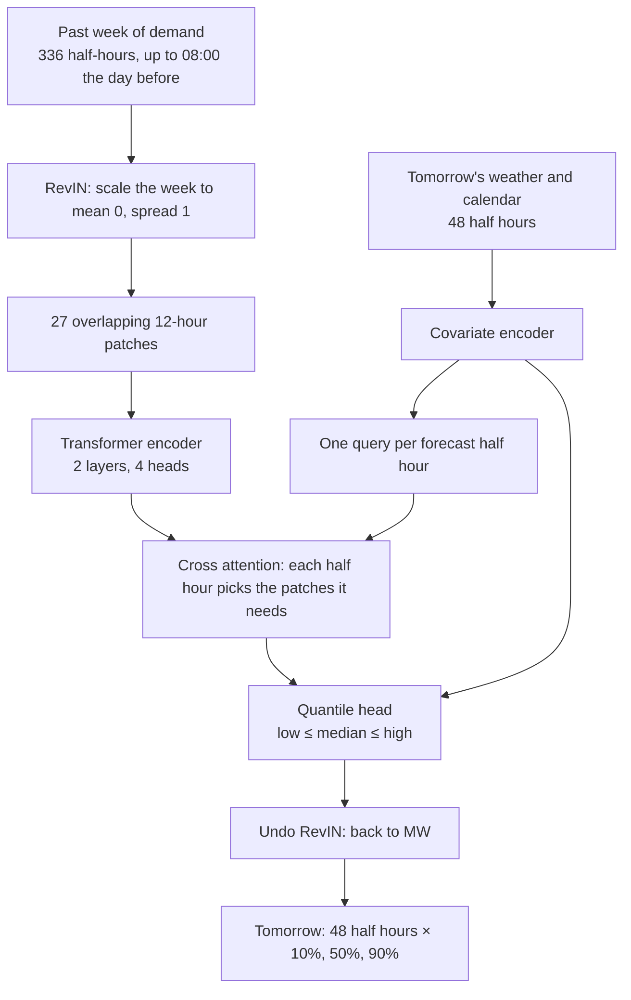
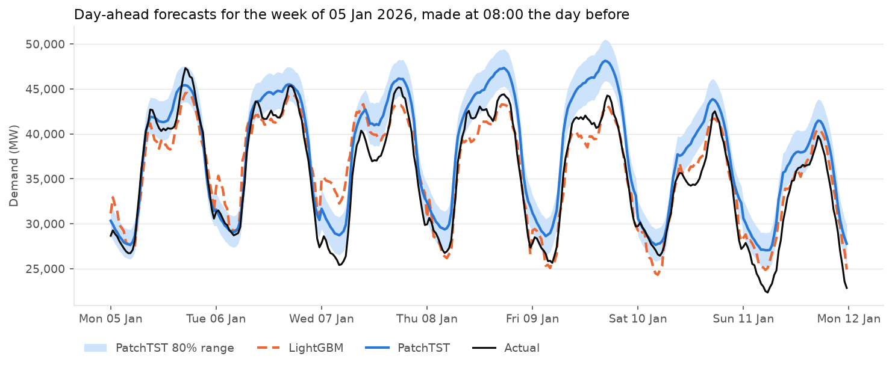
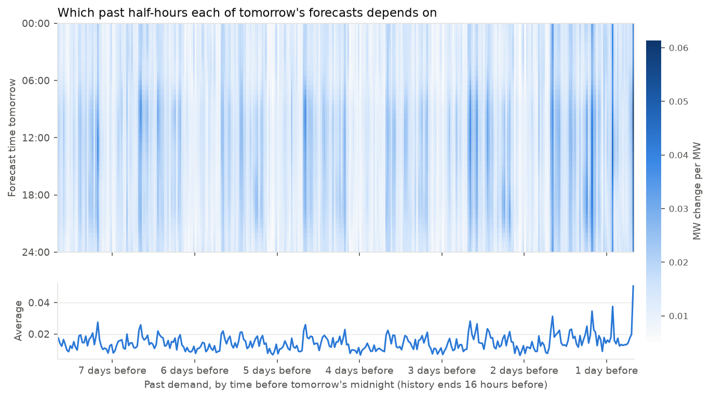
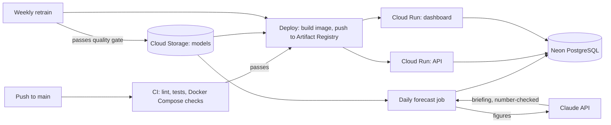

# GB Power Market Forecasting and Trading: End-to-End ML Pipeline

[](https://github.com/osamasibair/GB-Power-Market-Forecasting-and-Trading-End-to-End-ML-Pipeline/actions/workflows/tests.yml)
[](https://github.com/osamasibair/GB-Power-Market-Forecasting-and-Trading-End-to-End-ML-Pipeline/actions/workflows/deploy.yml)
[](https://github.com/osamasibair/GB-Power-Market-Forecasting-and-Trading-End-to-End-ML-Pipeline/actions/workflows/daily.yml)

An end to end machine learning pipeline that forecasts Great Britain's half hourly electricity demand and price one day ahead, from raw public data to a tested, containerised API, and backtests a battery trading strategy on the price forecasts.

**Live:** [API docs](https://electricity-api-xqiuvbbyca-nw.a.run.app/docs) · [Latest forecast](https://electricity-api-xqiuvbbyca-nw.a.run.app/forecast/latest) · [Dashboard](https://electricity-dashboard-xqiuvbbyca-nw.a.run.app) (live monitoring, plus price, spike, backtest and transformer results)

- **Demand: LightGBM day ahead model: 5.08% MAPE, about 40% lower error than a same-time-last-week baseline (8.40%), with 80% prediction intervals achieving 80.2% coverage.**
- **Price: LightGBM model with £21.50/MWh MAE, 15% lower than the best naive baseline, using wind, solar and net demand to forecast cheap and expensive periods.**
- **Spikes: LightGBM classifier that ranks spike risk 2.5x better than persistence (average precision 0.43 vs 0.17, ROC AUC 0.90).**
- **Backtest: a simulated 1 MW / 2 MWh battery scheduled from the price forecast earns 77% of the perfect foresight profit, against 52% for a baseline forecast and 74% for a simple average of the last 7 days prices.**
- **Transformer: a PatchTST transformer implemented and trained in PyTorch (5.61% MAPE) beats Amazon's pretrained Chronos model (7.29%) but not LightGBM (5.08%) on the same days. Blended 25/75 with LightGBM it beats both (4.97%), and attribution shows why the gain is small.**

**Stack:** Python, pandas, LightGBM, PyTorch, FastAPI, Docker, pytest, SciPy, Ruff, GitHub Actions, PostgreSQL, SQLAlchemy, Docker Compose, MLFlow, Streamlit, Google Cloud (Cloud Run, Artifact Registry, Cloud Storage, Secret Manager, Workload Identity Federation), Neon, Anthropic Claude API.

---

## Results

Test period: 1 September 2025 to 1 September 2026 (17,566 half-hours never seen in training).

### Demand forecast

| Model | MAE | RMSE | MAPE |
|---|---|---|---|
| Naive baseline (same time last week) | 2,132 MW | 2,878 MW | 8.40% |
| **LightGBM** | **1,241 MW** | **1,620 MW** | **5.08%** |

| Day | MAPE |
|---|---|
| Typical weekday (26 August 2026) | 2.67% |
| Christmas Day 2025 | 13.52% |

### Demand prediction intervals

Three LightGBM quantile models (q10, q50, q90) give an 80% prediction interval around each demand forecast. A well calibrated 80% interval should contain about 80% of actual values, with about 10% falling below and 10% above.

| Intervals | Coverage | Below | Above | Average width |
|---|---|---|---|---|
| Raw quantile models | 51.0% | 20.7% | 28.3% | 2,448 MW |
| Conformally calibrated | 75.7% | 11.2% | 13.1% | 3,964 MW |
| **Calibrated, models retrained on full training period** | **80.2%** | **9.3%** | **8.8%** | **4,204 MW** |

The raw quantile models were overconfident, covering only half of actual values. Calibration widened each interval by 758 MW, bringing coverage to the 80% target with misses balanced on both sides. The intervals also adapt to the time of day: they are narrowest overnight (around 3,000 MW) and widest around midday (up to around 6,000 MW).

### Transformer challenger (PatchTST)

Can deep learning beat gradient boosting here? A PatchTST transformer, implemented from the paper in PyTorch and adapted for day ahead forecasting, was compared with LightGBM and with Chronos-Bolt, Amazon's pretrained time series model, used zero shot.



Every model sees the same information (demand up to 08:00 the day before, plus tomorrows weather and calendar), gets the same conformal calibration from the calibration year, and is scored on the same 363 test days. Clock change days are skipped for all of them, which is why LightGBM scores 5.08% here rather than 5.03%.

| Model | MAE | RMSE | MAPE | 80% interval coverage | Average width |
|---|---|---|---|---|---|
| Naive baseline (same time last week) | 2,130 MW | 2,875 MW | 8.39% | — | — |
| Chronos-Bolt small (pretrained, zero shot) | 1,839 MW | 2,437 MW | 7.29% | 78.6% | 5,614 MW |
| PatchTST (trained here) | 1,368 MW | 1,793 MW | 5.61% | 77.7% | 4,135 MW |
| **LightGBM** | **1,246 MW** | **1,647 MW** | **5.08%** | **80.2%** | **4,035 MW** |
| Blend: 75% LightGBM + 25% PatchTST | — | — | 4.97% | 79.2% | 3,796 MW |





- **The transformer beats the pretrained model by 23% but not LightGBM.** LightGBM stays in production. This matches what forecasting competitions such as M5 found: gradient boosting with good features is hard to beat on a few years of data.
- **Letting each forecast half-hour choose what to look at helped most.** The papers head flattens the 27 patch summaries into one long vector, through a single layer holding 221,312 of the model's 347,525 parameters. Three heads were compared on the same days with `src/ablation.py`:

  | Head | Parameters | MAPE | 80% interval coverage | Average width |
  |---|---|---|---|---|
  | Flatten (paper) | 347,525 | 5.98% | 78.7% | 4,656 MW |
  | Mean of the patches | 134,533 | 5.88% | 79.4% | 4,538 MW |
  | **Cross attention** | **153,413** | **5.61%** | **77.7%** | **4,135 MW** |

  Averaging helps a little. Cross attention, where each of tomorrow's half hours builds a query from its time of day, weather and calendar and picks the patches it needs, cut the error by 6% and the interval width by 11% with 56% fewer parameters.

- **Attribution shows what changed.** The heatmap shows how much each of tomorrow's forecasts moves when each past half hour changes (the gradient of the forecast, averaged over every test day). With the flatten head, the stripes were vertical: every past half hour affected every forecast about equally, so the past week only set tomorrow's level. With cross attention, the influence peaks at the same times every day across the week and is stronger for daytime forecasts than overnight ones, so the transformer has learned to match times of day, as LightGBM does with its same time yesterday and same time last week features. The most recent full day matters most.
- **Giving it the matching past half-hours directly added nothing.** Feeding each forecast half-hour the demand at the same time 2 and 7 days earlier, LightGBM's strongest kind of feature, moved test MAPE from 5.61% to 5.60%. Cross attention had already learned to find those values itself, as the heatmap shows.
- **Tuning overfitted the calibration year, and made the transformer more like LightGBM.** Optuna searched 40 settings (learning rate, dropout, model size, patch length, lags), scored only on the calibration year, with median pruning. The winner, a smaller model with one layer and day long patches, cut calibration year error by 7%, but averaged over three random seeds it matched the default on the test year (5.61% ± 0.07 vs 5.58% ± 0.10), with 69% fewer parameters and better coverage (79.4%). Comparing 40 settings on one year picks partly the setting that suits that year. Its attribution map shows why it blends worse: it relies almost entirely on the demand 2 and 7 days before each half hour, as LightGBM does ([heatmap](docs/patchtst_influence_tuned.png)), so it repeats LightGBM's mistakes, such as under forecasting the first working day after New Year when both lag days fell in the holiday. The default settings were kept.
- **Blending still helps, but less than the transformer's own gain suggests.** 75% LightGBM and 25% PatchTST, with the weight chosen on the calibration year, gives 4.97% MAPE against 5.08% for LightGBM, with 80% intervals 6% narrower at 79.2% coverage. With the weaker flatten head the blend scored 4.98%: as PatchTST learned to match times of day, its errors became more like LightGBM's, so it improved alone more than it adds to the blend.
- **Training is noisy.** The calibration loss jumps between epochs and early stopping picks epoch 8 with every head ([learning curve](docs/patchtst_learning_curve.png)), so tuning the learning rate and dropout is the next step.

### Price forecast

The target is the Market Index Price, the half hourly price of electricity traded in the short term market. Prices can be negative, so models are scored on MAE and RMSE in £/MWh rather than MAPE.

| Model | MAE | RMSE |
|---|---|---|
| Naive baseline: same time last week | £27.57 | £41.25 |
| Naive baseline: most recent known day | £25.25 | £39.22 |
| **LightGBM** | **£21.50** | **£29.45** |

LightGBM is 15% better than the stronger baseline on MAE and 25% better on RMSE. The larger RMSE improvement means it mostly avoids the big misses the baselines make, by seeing windy, cheap periods and tight, expensive ones coming.

**Feature selection on a validation year.** The first price model relied heavily on `dayofyear`. Unlike demand, price levels drift between years with gas prices (around £150/MWh in early 2023, around £70 in 2024, rising again through 2026), so seasonal patterns learned from past years don't generalise. Comparing feature sets on a held-out validation year (September 2024 to August 2025), removing `dayofyear` improved MAE from £18.57 to £17.12 (7.8%). That version was chosen before the test set was evaluated, then tested once.

### Price spike classifier

A spike is defined relative to the recent price level: **a price more than £43.72/MWh above its own 7 day average**. The threshold was set so that 5% of training half-hours count as spikes, using training data only. The test year was more volatile, with 6.3% spikes.

The baseline is persistence: predict a spike if the most recent known price at that time was itself spike-level.

| Model | Precision | Recall | F1 | Average precision |
|---|---|---|---|---|
| Random guessing | — | — | — | 0.063 |
| Persistence | 0.39 | 0.33 | 0.36 | 0.170 |
| LightGBM, 0.5 cut-off | 0.75 | 0.12 | 0.21 | **0.428** |
| LightGBM, cut-off chosen on validation (0.30) | 0.59 | 0.19 | 0.29 | **0.428** |

ROC AUC: 0.899.

- **The classifier ranks risk far better than persistence.** Its average precision, which scores the probabilities across every possible cut off, is 2.5 times persistence's and nearly 7 times random guessing.
- **Its alarms are more precise:** 59% of half hours it flags are real spikes, against 39% for persistence.
- **At a single cut off it catches fewer spikes:** Persistence scores a slightly higher F1. The cut off was chosen on the validation year, and the more volatile test year needed a less cautious one. It was not retuned on the test set.
- In the battery backtest below, using the spike probabilities to adjust the price forecast added no profit. The classifier ranks risk well, but its signal doesn't change one cycle a day trading decisions.

**Feature choice:** Tree models split on one feature at a time, so they can't easily compute the difference between two features. Adding `price_excess_recent` (the most recent known price minus its 7 day average, persistence's own signal) raised validation average precision from 0.405 to 0.412 and was kept.

### Battery trading backtest

Does a more accurate forecast actually make more money? A simulated battery plans each day's charging and discharging from a price forecast, using linear programming to find the most profitable schedule, and the plan is then scored on the real prices.

**Battery:** 1 MW power, 2 MWh storage, 90% round-trip efficiency, at most one full cycle a day, each day starting empty.

| Strategy | Forecast used to plan | Profit over test year | Share of perfect foresight | Losing days |
|---|---|---|---|---|
| Perfect foresight | Real prices (upper limit) | £42,937 | 100.0% | 0 |
| LightGBM | Price model | **£33,095** | **77.1%** | 17 |
| LightGBM + spike model | Price model, raised to the spike level where spike probability passes the cut-off | £33,048 | 77.0% | 16 |
| 7-day average | Average price at the same half-hour over the last 7 known days | £31,872 | 74.2% | 24 |
| Recent day | Most recent known price at each half hour | £22,377 | 52.1% | 45 |

- **The forecast is worth real money:** about £10,700 a year more than the recent day forecast (+48%), with far fewer losing days.
- **Most of the value comes from the daily shape.** Simply averaging the last 7 days prices captures 74%. A battery only needs to know when prices are low and high, not their exact level, so LightGBM's accuracy advantage turns into only about £1,200 (4%) more profit than the 7 day average.
- **The spike model doesnt change the outcome.**
- **The LightGBM result is an upper bound.** The price model uses actual wind, solar and demand rather than forecasts, so with real inputs its small lead over the 7 day average could shrink. The 7 day average uses only past prices, so its result is fully realistic.

### Monitoring

The demand model was replayed over the test year day by day, as if each day had just arrived, and scored on accuracy, interval coverage and input drift (`src/monitor.py`, shown on the Streamlit dashboard).

- **Interval coverage** stayed near or above the 80% target for most of the year, but the 30 day coverage fell below 70% on 12 days, all over Christmas and New Year (lowest about 66% in mid January). Coverage holds over the year as a whole, not in every period.
- **Accuracy** was no better than the same time last week baseline (7 day average) on 26 days, in three spells: 2 January, 31 January to 9 February, and 18 July to 4 August. The July spell coincides with the largest input drift of the year: temperature in July 2026 differed sharply from the training years Julys (PSI 0.97), giving the model weather it had seen little of.
- **Input drift:** sunshine and recent demand stayed stable or moderate (PSI up to 0.13 and 0.20, the latter over Christmas), but temperature shifted by more than 0.25 in half the months, because weather comes in spells lasting days or weeks.

### Live forecasts

Each morning the daily job also asks Claude (Haiku, Anthropic API) to turn the day's figures, meaning tomorrow's peak and low, interval width, recent accuracy against the baseline, coverage and any alerts, into a short english briefing shown at the top of the dashboard. Before it is saved, every number in the briefing is checked against the figures Claude was given. If any number doesn't match (allowing for rounding), the briefing is rejected and the reason is logged, so a hallucinated figure can't reach the dashboard. If the API is unavailable, the forecast job carries on without a briefing.

Since October 2026, a scheduled job forecasts the next days demand every morning from the latest Elexon demand and an Open Meteo **weather forecast**, the inputs a real forecaster would have. Each forecast is scored once that days actual demand is published, with the same daily accuracy, baseline and coverage checks as the replay above, and shown on the live dashboard. The model is trained and tested on archived weather forecasts rather than measured weather, so the test results already include the effect of weather forecast errors, and the live scores check that this holds in practice.

### What the data shows about prices

- **Daily shape:** an evening peak at 6–7pm UK time (about £112/MWh on average), a smaller morning peak, an overnight dip (about £69), and a midday dip (about £74) caused by solar.
- **Fat tails:** the middle half of prices sits between £68 and £104/MWh, but prices ranged from −£102.92 to £1,352.90.
- **Negative prices** occurred in 1,684 half hours (2.6%), clustered around midday from solar and overnight on windy nights with low demand, and concentrated between April and September. They almost never occur during the evening peak.

### Error analysis

- **Solar:** errors peaked in the middle of the day, at 2.0–2.4 GW around midday compared with about 1 GW overnight. Rooftop solar isn't measured in this demand data, so sunny days reduce the demand the grid sees. Adding shortwave radiation as a feature reduced MAPE from 5.66% to 5.04%.
- **Christmas:** Christmas Day had a MAPE of 14.8%, with only two Christmases in the training data. A Christmas-period flag reduced this to 13.5%, but the model still overestimates demand.
- **Peaks:** the model gets the shape of each day right but underestimates the extremes, forecasting too low at the morning ramp and the evening peak.

---

## Quick start

The data and trained model aren't stored in the repository, so the pipeline has to be run once to create them.

**1. Set up and run the pipeline**

The pipeline stores its processed data in PostgreSQL, which runs in Docker.

```bash
python -m venv venv
source venv/bin/activate
pip install -r requirements.txt

docker compose up -d db        # start PostgreSQL 
python src/ingest.py           # download demand and weather data
python src/validate.py         # check data quality
python src/preprocess.py       # clean, align and join
python src/features.py         # build model features
python src/train.py            # train and compare with the baseline
python src/quantiles.py        # train and calibrate the prediction intervals
python src/price_features.py   # build price features
python src/train_price.py      # select features, train the price model, compare with baselines
python src/spikes.py           # train the spike classifier and choose its cut off
python src/battery_backtest.py # backtest battery trading strategies and save the results for the dashboard
python src/monitor.py          # replay the test year and save the monitoring tables
python src/live.py             # forecast tomorrow from live data and score earlier live forecasts
Set `ANTHROPIC_API_KEY` to also write the daily Claude briefing. Without it, `live.py` skips the briefing and runs as normal.
```
**Transformer experiments** These need PyTorch, which the deployed API doesn't use, so it's kept out of `requirements.txt` and the Docker image:

```bash
pip install -r requirements-research.txt
python src/train_patchtst.py   # train PatchTST and compare it with LightGBM and Chronos on the same days
python src/plot_patchtst.py    # draw the figures in docs/
python src/ensemble.py         # blend LightGBM and PatchTST, choosing the weight on the calibration year
python src/ablation.py pooling flatten mean attention   # compare settings, here the three heads
```

Each training script logs its settings, results and model to MLflow. Open `http://localhost:5001` to browse and compare runs, and to see model versions.
On macOS, LightGBM needs OpenMP first: `brew install libomp`

**2. Serve forecasts and the dashboard**, with Docker Compose:

```bash
docker compose up --build
```

This starts the database, the API (`http://localhost:8000/docs`), the monitoring dashboard (`http://localhost:8501`) and MLflow (`http://localhost:5001`).

or locally, with the database already running:

```bash
uvicorn api.main:app --reload
```

Then open `http://127.0.0.1:8000/docs` for interactive API documentation.

**3. Run the tests**

```bash
pytest
ruff check .
```

Every push runs CI on GitHub Actions; Ruff linting, a PostgreSQL database started with Docker Compose, the test suite with coverage, and the API container started with Docker Compose and checked by requesting a forecast. In CI, the tests run against a small model and features table built from synthetic data, since the real data and models aren't stored in the repository. The script that creates them refuses to run outside CI, so it can't overwrite real models. Dependabot opens weekly pull requests for dependency updates.

When CI passes on `main`, the deploy workflow builds the image with the current models, pushes it to artifact registry tagged with the commit ID, deploys the API and dashboard to cloud run, and checks the live API returns a forecast.

---

## API

| Endpoint | Description |
|---|---|
| `GET /health` | Returns `{"status": "ok"}` if the service is running |
| `GET /predict?day=YYYY-MM-DD` | Half-hourly forecast, 80% preditcion interval and actual demand for that day, with the day's MAE and MAPE |
| `GET /forecast/latest` | The newest live forecast (normally tomorrow), with its 80% interval; returns 404 until the first daily run |

Example response (trimmed):

```json
{
  "date": "2026-08-26",
  "in_training_data": false,
  "mae": 668,
  "mape": 2.67,
  "interval": "80%",
  "forecast": [
    {"timestamp_utc": "2026-08-25T23:00:00", "low": 20175, "forecast": 21673, "high": 22963, "actual": 22284}
  ]
}
```

`in_training_data` is `true` when the requested day was part of the training set, where results look better than the model's real performance. Invalid dates return 422, and dates outside the data return 404.

A single day can also be forecast from the command line: `python src/predict.py 2026-08-26`

---

## How it works

### Deployment



### Pipeline

| Stage | File | Purpose |
|---|---|---|
| Ingest | `src/ingest.py` | Downloads demand from Elexon in weekly chunks and weather from Open Meteo |
| Validate | `src/validate.py` | Checks for missing periods, duplicates, nulls, out of range values and date coverage |
| Explore | `notebooks/exploration.ipynb` | Daily, weekly and seasonal patterns, temperature relationship, autocorrelation, holidays |
| Preprocess | `src/preprocess.py` | Converts to UTC, fills gaps, resamples weather to half hourly, joins the sources and saves them to PostgreSQL |
| Database | `src/db.py` | Saves and loads tables in PostgreSQL; every stage after preprocessing reads and writes through it |
| Features | `src/features.py` | Builds calendar, weather and lag features |
| Train | `src/train.py` | Trains LightGBM with a time based split and compares it with the baseline |
| Quantiles | `src/quantiles.py` | Trains q10/q50/q90 models and calibrates the prediction intervals |
| PatchTST | `src/patchtst.py`, `src/forecast_windows.py` | The transformer (RevIN, patching, encoder, quantile head) and its training loop, and the forecast windows every model is scored on |
| Transformer comparison | `src/train_patchtst.py` | Trains PatchTST with early stopping, calibrates it, and compares it with LightGBM and Chronos on the same test days |
| Transformer figures | `src/plot_patchtst.py` | Draws a forecast week, the learning curve and the attribution heatmap into `docs/` |
| Ensemble and ablations | `src/ensemble.py`, `src/ablation.py` | Blends LightGBM and PatchTST with the weight chosen on the calibration year, and retrains PatchTST once per value of a setting to compare them |
| Retrain | `src/retrain.py` | Checks a newly trained model against the baseline on the latest 8 weeks, then retrains the demand and interval models on all data and recalibrates the intervals |
| Price features | `src/price_features.py` | Adds wind, solar, net demand and price lag features |
| Price model | `src/train_price.py` | Selects features on a validation year, trains LightGBM and compares it with two baselines |
| Spikes | `src/spikes.py` | Labels price spikes, selects features and a probability cut-off on a validation year, and compares the classifier with persistence |
| Backtest | `src/battery_backtest.py` | Plans each day's battery schedule from a price forecast with linear programming and scores it on real prices over the test year |
| Monitor | `src/monitor.py` | Replays the test year day by day: daily error against the baseline, interval coverage and monthly input drift, saved to PostgreSQL |
| Live | `src/live.py` | Fetches the last 21 days of demand and a weather forecast, forecasts tomorrow, and scores earlier live forecasts once their actual demand is known |
| Briefing | `src/briefing.py` | Sends the day's figures to Claude for a short english briefing, and rejects it if it contains any number not in those figures |
| Dashboard | `dashboard/app.py` | Streamlit dashboard with live demand monitoring page (forecasts, accuracy, coverage, drift and freshness, with alerts) and research pages for the price forecast, the spike classifier, the battery backtest and the transformer comparison |
| Evaluate | `src/evaluate.py` | MAE, RMSE, MAPE and quantile loss |
| Tracking | `src/tracking.py` | Logs each training runs settings, metrics and model files to MLflow, and registers the demand, price and spike models |
| Predict | `src/predict.py` | Loads the saved models and forecasts a chosen day with interval |
| Serve | `api/main.py` | FastAPI service, packaged with the `Dockerfile` and run alongside PostgreSQL with `docker-compose.yml` |
| Test | `tests/` | Unit tests for metrics, features, the spike definition, the battery, the monitoring, the database, the briefing (using a mocked Claude client), and the transformer (no look ahead in its windows, non crossing quantiles, reproducibility, saving and loading), plus API tests |
| CI | `.github/workflows/tests.yml` | Lints, starts PostgreSQL, runs the tests with coverage, and starts the API and dashboard with Docker Compose on every push |
| Scheduled retraining | `.github/workflows/retrain.yml` | Every Monday, downloads the latest data, rebuilds the features and runs the retraining, publishing if the quality gate is passed |
| Deploy | `.github/workflows/deploy.yml` | After CI passes on `main`, or after a retrain, builds and pushes the image and deploys the API and dashboard to cloud run |
| Daily forecast | `.github/workflows/daily.yml` | Every day at 10:00 UTC, runs `src/live.py` against the hosted database |

### Data

- **Demand:** Initial national demand outturn from the Elexon BMRS API, half hourly, January 2023 to September 2026 (64,316 settlement periods).
- **Weather:** Hourly temperature, wind speed and shortwave radiation for London from the Open Meteo historical forecast API, interpolated to half hourly. These are archived weather forecasts rather than measured weather, so the model trains on the same kind of input it gets live, where the daily job uses the Open Meteo forecast API. Training on measured weather and serving on forecasts would make the model rely on weather inputs more than live forecasts can support.
- **Prices:** Market Index Price (APX/EPEX) from the Elexon BMRS API. Six missing half hours and 34 half hours with zero traded volume were filled by interpolation.
- **Wind and solar generation:** Actual onshore wind, offshore wind and solar generation from the Elexon BMRS API. 4,383 republished duplicate rows were removed (keeping the latest version), 863 missing half-hours (longest gap 7 hours) were filled by interpolation, and 15 small negative values were set to zero.
- **Storage:** Raw downloads are kept as CSV files, untouched. Everything from cleaning onwards is stored in PostgreSQL tables: `dataset`, `market`, `features` and `price_features`, plus `monitoring_daily` and `monitoring_drift` for the replay, `live_forecasts`, `live_briefing` and `monitoring_live` for live forecasts, `backtest_daily`, `price_forecasts`, `transformer_forecasts`, `transformer_training`, `transformer_influence`, `ensemble_weights` and `transformer_ablation` for the research pages.

Validation found two days each missing one settlement period (2023-07-17 period 45 and 2023-12-29 period 8), which were filled by time interpolation.

### Features

| Feature | Description |
|---|---|
| `period` | Settlement period (1–48), in UK local time |
| `dayofweek`, `dayofyear` | Calendar position |
| `is_holiday` | England and Wales bank holidays |
| `is_christmas` | 24 December to 1 January |
| `temperature_2m` | Air temperature (°C) |
| `hdd` | Heating degree days: max(0, 15.5 − temperature) |
| `shortwave_radiation` | Sunlight reaching the ground (W/m²), a proxy for rooftop solar output |
| `demand_lag_recent` | Demand at the same time yesterday, or two days ago (see below) |
| `demand_lag_336` | Demand at the same time last week |
| `demand_roll_96` | 24 hour average demand ending two days earlier |

Wind speed was dropped because it had almost no correlation with demand (0.03).

### Price features

The price model uses the demand, weather and calendar features (without `dayofyear`) plus:

| Feature | Description |
|---|---|
| `wind_onshore`, `wind_offshore`, `wind_total` | Wind generation (MW) |
| `solar_generation` | Solar generation (MW) |
| `net_demand` | Demand minus wind and solar: what's left to be met mostly by gas, which usually sets the price |
| `price_lag_recent` | Price at the same time yesterday, or two days ago (same rule as demand) |
| `price_lag_336` | Price at the same time last week |
| `price_roll_7d` | 7 day average price ending two days earlier, which tells the model the current price level |

### Design decisions

**A realistic day-ahead forecast.** The forecast for a given day is assumed to be made around 9am the day before, in line with GB day ahead power auctions, which run in the morning. At that point, yesterday's demand is only known up to about 8am. So `demand_lag_recent` uses lag 48 (yesterday) for periods before 8am local time and lag 96 (two days ago) from 8am onwards. Using lag 48 everywhere would quietly use data a real forecaster wouldn't have yet. A unit test enforces this rule, and the rolling average is shifted by 96 periods for the same reason.

**Time-based split.** Training data ends on 31 August 2025 and testing starts on 1 September 2025, so the model is never trained on data from after the period it's tested on.

**Conformal calibration of the intervals.** Quantile models learn their spread from training data they fit closely, so their intervals come out too narrow on new data. To correct this, the quantile models were first trained on data up to August 2024 and evaluated on a held out calibration year (September 2024 to August 2025). The amount by which actual values fell outside their intervals gave a 758 MW adjustment, the widening needed for 80% of calibration values to fall inside. The final models were retrained on the full training period and the same adjustment applied.

**Timezones.** Timestamps are stored in UTC to avoid duplicate and missing hours at the clock changes. Calendar features use UK local time, because that's when people actually use electricity.

**Net demand for prices.** Prices are set by supply and demand together. Low demand alone doesn't explain negative prices (overnight demand is low every night, but prices go negative on only a small share of nights), whereas low demand combined with high wind or solar does. Net demand captures this directly.

**Separate market data.** Prices and generation are stored in their own table, so adding them didn't change the demand pipeline or its results.

**Spikes relative to the recent level.** Price levels drift by a factor of two between years, so a fixed threshold such as "above £150/MWh" would label most of early 2023 as spikes and almost nothing in 2024, and the classifier would simply learn which periods were expensive. Defining a spike as a jump above the recent 7 day average captures sudden, unusual prices whatever the current level.

**PostgreSQL for processed data.** Raw downloads stay as CSV files so everything can be rebuilt without calling the APIs again, but every processed table lives in one place, the database, so training, backtesting and the API always read the same data. The connection comes from a `DATABASE_URL` environment variable, so the same code runs on a laptop, inside Docker Compose and in CI.

**Scheduled retraining with a quality gate.** Demand patterns drift as solar capacity grows and behaviour changes, so the models are retrained weekly on the latest data. Before anything is saved, a model trained without the most recent 8 weeks must beat the same time last week baseline on them, otherwise the run fails and the previous models are kept. The interval calibration is recomputed on the same recent weeks. The READMEs results use data up to 1 September 2026 so they stay reproducible, only the retraining workflow fetches newer data.

**Experiment tracking with MLflow.** Every training run records its settings, metrics and model files in MLflow, so results can be compared across runs and any past model can be recovered exactly. The demand, price and spike models are registered as numbered versions. The MLflow server runs in Docker Compose, storing its records in a separate PostgreSQL database and its model files in a Docker volume.

**Monitoring alerts on performance, not on drift alone.** Input drift is measured with the population stability index against the same calendar month in the training years, because comparing a summer month with a whole training year would flag every season as drift. Even so, temperature shifts by more than 0.25 in half the months, since a single month holds only a handful of weather spells, so a drift alert would fire constantly and be ignored. Alerts are therefore based on accuracy (7 day error no better than the baseline), interval coverage (30 day coverage below 70%) and data freshness, and drift is shown as a likely explanation when accuracy drops, as it did in July 2026.

**Serverless deployment on Google Cloud.** The API and dashboard run on cloud run from the same image, so they scale to zero when idle and cost almost nothing. The first request after a quiet spell takes 10–20 seconds while a container starts and loads the data. The database is neons hosted PostgreSQL in London, next to the cloud run region, because Googles own Cloud SQL has no free tier. The database URL is kept in Secret Manager, not in code or in the image.

**Keyless, gated continuous deployment.** GitHub actions logs in to google cloud with workload identity federation: google trusts GitHubs tokens, but only from this repository, so no long lived key is stored anywhere. A dedicated service account can only deploy to cloud run, push to this projects registry and read and write the models bucket. Deploys happen only after CI passes, and each image is tagged with its commit, so any live version can be traced or rolled back. Models live in a cloud storage bucket rather than in git, and a retrained model reaches production only if it passes the quality gate.

**Grounded LLM briefings.** Language models can write convincing numbers that are wrong, which matters in a forecasting system. Claude is given only a short list of facts computed by the pipeline and told to copy numbers exactly, and the code then extracts every number from its reply and checks each one against those facts, allowing for rounding. A reply with any unmatched number is discarded. The model never sees raw data or produces forecasts itself, so it explains results rather than creating them. The API key lives in a GitHub Actions secret, the key is scoped to a single workspace, and the tests use a mocked client, so CI runs without a key or any cost.

**Transformer comparison.** PatchTST sees exactly what the live job has at 08:00 the day before: the previous 7 days of demand, then a 16 hour gap, then tomorrow's weather and calendar. RevIN (reversible instance normalisation) scales each week to mean 0 and spread 1 and undoes it on the output, so the model learns the shape of demand and copes as the overall level drifts between seasons and years. The quantile head predicts the median plus two positive gaps, so its 10%, 50% and 90% forecasts can never cross. It's trained with AdamW, a warmup then cosine learning rate schedule, gradient clipping and early stopping on the calibration year, then refitted on the full training period for the best number of epochs, mirroring how the LightGBM intervals are built. On macOS, LightGBM and PyTorch each load their own OpenMP threading library and freeze or crash when both run in one process, so the comparison scores LightGBM in a separate process.

---

## Limitations

- The archived weather forecasts are stitched together from the first hours of each forecast run, which are more accurate than the day ahead forecasts available when a real forecast is made, so the test results may still slightly overstate live accuracy. Live forecasts are scored separately on the dashboard to measure this.
- Weather comes from London only, while national demand depends on weather across Great Britain, especially for solar.
- Holidays follow the England and Wales calendar; Scotland and Northern Ireland differ.
- MLflow runs locally only, so the weekly retraining on githubs machines isn't tracked there. Retrained models are versioned by their report in cloud storage and kept as 30 day workflow artifacts instead.
- The price and spike models arent served live, because live price forecasts would need wind and solar generation forecasts.
- Interval coverage holds over the test year as a whole, not on every day, so easy days are covered more often and unusual days (such as Christmas) less often. The choice to apply the calibration to retrained models was checked once against the test set.
- The price model has no gas price input, although gas usually sets GB power prices. The 7-day average price captures its effect only indirectly.
- Half hourly prices are noisy, and extreme spikes and negative prices remain hard to predict.
- A spike probability cut off chosen on one year transfers imperfectly to a more volatile year, in practice it would need recalibrating regularly.
- The briefing check verifies that every number came from the source figures, but not that it's attached to the right label (a real MAPE figure described as coverage would pass), and it can't check numbers written as words.
- PatchTST is untuned, as it uses one set of reasonable settings, not a hyperparameter search. Chronos-Bolt is asked for 80 steps ahead (the 16 hour gap plus tomorrow), beyond the 64 it was trained for, which may understate it.

---

## Data sources and licences

- Contains BMRS data © Elexon Limited copyright and database right 2026. [Licence](https://www.elexon.co.uk/bsc/data/balancing-mechanism-reporting-agent/copyright-licence-bmrs-data/)
- Weather data by [Open-Meteo.com](https://open-meteo.com/), licensed under [CC BY 4.0](https://creativecommons.org/licenses/by/4.0/).
